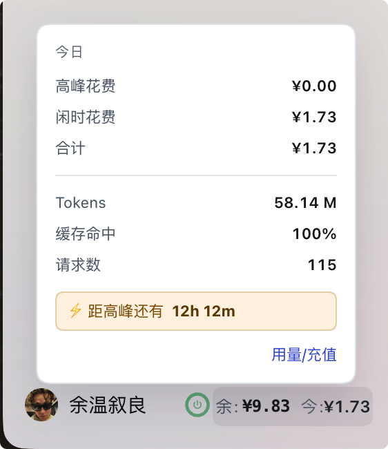

# dsh-quota-ring · DSH 余额环

在 DSH 侧边栏**左下角、账户名右侧**，显示 **余额**、**今日花费** 和 **峰谷计价圆环**。

> ⚠️ **仅支持 macOS** —— 重启功能依赖 `launchctl` 与 `/Applications` 路径。
>
> ✅ **无需安装 Node，无需 `npm install`** —— 插件跑在 DSH 内部，而 DSH 是 Electron 应用，自带 Node 运行时。整个插件零第三方依赖。


<sub>浅色模式下的完整界面。余额环在左下角，和账户名同一行。</sub>

---

## 它解决什么问题

想知道账户还剩多少钱，平时要：打开网页 → 登录 → 进用量页 → 看一眼 → 关掉。

这个插件把三个信息钉在侧边栏上，扫一眼就知道：

| 你看到的 | 含义 |
|---|---|
| `余:¥9.89` | 账户**当前余额**（平台接口真实值） |
| `今:¥1.71` | **今天已花费**（扫描本地会话日志 + 内置价目表估算） |
| **圆环** | 今天的花费**构成** + 此刻是**高峰还是闲时** |

---

## 一、徽章长什么样


<sub>深色模式。从左到右：**圆环** → 「余:」→ 余额 →「今:」→ 今日花费。</sub>


<sub>浅色模式。同一套布局，文字变深、背景变浅，自动跟随 DSH 主题。</sub>

三个部分：

1. **圆环** —— 状态指示器，也是一个可点的按钮（点它重启 DSH）
2. **`余:¥9.89`** —— 当前余额
3. **`今:¥1.71`** —— 今天花了多少

---

## 二、圆环的三种颜色，分别是什么意思

### 🟢 绿环 = 闲时（便宜时段）


现在是**闲时**，单价便宜。环心那个电源图标也是灰绿色。

### 🟡 黄环（琥珀）= 高峰（贵时段）

高峰时段：**工作日 09:00–12:00、14:00–18:00**（北京时间）。

这段时间单价翻倍，所以环心和高峰段都变成琥珀色 `#ffb020`，提醒你「现在用会贵」。

### 🔴 红环 = 余额不足 ¥3

余额低于 **¥3** 时：

- **环心图标变红** `#ff5c7a`
- **高峰段变红**（闲时段仍是灰绿）
- **徽章外面出现红色呼吸光晕**（2 秒一次，一明一暗）

这是一道"快去充值"的警示。

### ⚠️ 一个容易误会的细节：圆环其实是**两段**

圆环不是整环一个颜色，而是按**今天的钱花在哪**切开的：

| 环上的部分 | 代表 |
|---|---|
| 琥珀色那段 | 今天在**高峰**花的钱（占比） |
| 灰绿色那段 | 今天在**闲时**花的钱（占比） |

所以：

- 整环几乎全绿 → 今天的钱基本都在闲时花的（省钱）
- 琥珀段很长 → 今天有相当比例是在高峰时段烧掉的（费钱）

**环心图标的颜色**才代表「**此刻**是高峰还是闲时」。

---

## 三、数字的翻转 + 变色（最容易忽略的一个功能）

每次数值变化，数字不是"直接跳"，而是**翻一下 + 变个色**。

### 翻转是怎么动的

每个字符（包括 `¥` 和小数点）都是独立的，变化时会：

1. 从**下方 7px** 浮上来，同时从**半透明**变成实心
2. 持续 **0.45 秒**
3. 每个字符**依次延迟 18 毫秒**

所以看起来是**从左到右一波推过去**，像老式翻牌器。

### 变色是什么意思

| 变化 | 颜色 | 含义 |
|---|---|---|
| **余额增加** | 灰绿 `#96C6A9` | 充值到账 |
| **余额减少** | 粉红 `#ff8fa3` | 钱在变少 |
| **今日花费增加** | **黄色 `#ffb020`** | 又来一笔消耗 |
| **今日花费减少** | 粉红 `#ff8fa3` | 罕见（跨天归零时） |


<sub>今日花费从 ¥1.71 涨到 ¥1.73 ——「今:¥1.73」整串变**黄色**，表示刚刚又花了一笔。</sub>


<sub>余额从 ¥9.86 降到 ¥9.83 ——「余:¥9.83」整串变**粉色**，表示钱在减少。</sub>

### 为什么"今日上涨"用黄色，不是绿色

因为「今日花费」是**支出**。

如果花钱也变绿，会给人"情况变好"的错觉 —— 实际上是钱在流出。所以改成黄色（警示色），和「余额减少」的粉色区分开：

- **余额涨** = 绿（好事）
- **余额跌** = 粉（坏事）
- **今日花费涨** = 黄（在花钱）

### 颜色停留多久

变色会保持 **1.7 秒**，然后自动恢复默认颜色。这样既看得见变化，又不会一直花花绿绿。

---

## 四、悬停数字 → 弹出今日明细

鼠标移到**数字**上，会弹出一个面板：


<sub>深色模式：灰底弹层，浮在账户行上方，水平居中于侧边栏。</sub>



<sub>浅色模式：同一个面板，白底深字。</sub>

面板里每一行：

| 行 | 含义 |
|---|---|
| **今日** | 下面三行都只统计今天（本地时间 0 点起） |
| **高峰花费** | 今天在高峰时段花的钱 |
| **闲时花费** | 今天在闲时时段花的钱 |
| **合计** | 上面两项之和 = 今天的总花费 |
| **Tokens** | 今天一共消耗了多少 token（含输入、输出、缓存） |
| **缓存命中** | 缓存命中率 = 命中 token ÷ 总 token |
| **请求数** | 今天发了多少次请求 |
| **⚡ 距高峰还有 12h 14m** | 距离下一次峰谷切换还有多久 |
| **用量/充值** | 点击跳转到平台的用量页面 |

> 💡 这些数字是**本地估算**：插件读本机的会话日志，乘以内置价目表算出来的。
> 而「余额」是平台接口返回的真实值。两者数据源不同，所以不会严格同步 —— 这是设计如此。

---

## 五、悬停圆环 → 只亮圆形，不弹面板


<sub>鼠标停在圆环上：圆环后面出现一个**圆形**灰底高亮，**不会**弹出明细面板。</sub>

为什么要这样区分：

- 悬停**圆环** = 你想点重启按钮 → 只给一个圆形的"这里可以点"的反馈
- 悬停**数字** = 你想看明细 → 才弹出面板

两个高亮的**形状不同**（一个是圆、一个是圆角矩形），一眼就知道自己悬停在哪一块，不会误触。

---

## 六、单击刷新

点一下**数字区域**，立即重新读取余额和今日花费，同时圆环上会有一段缺口绕圈转动（表示正在刷新）。

底部还有每 **60 秒**一次的自动刷新。

---

## 七、点圆环 → 重启 DSH

改完插件代码后，不用手动退出再打开：

1. 点圆环 → 弹出确认框「重启 DeepSeek Harness？」
2. 点「是」→ 界面锁定为「重启进行中，请稍候……」
3. 应用退出并自动重新打开

几个保护：

- **提交后不能关弹窗** —— 避免"关掉了但后台还在重启"的错觉
- **60 秒内不能重复点** —— 防止打断正在执行的重启任务
- **60 秒超时** —— 万一没重启成功，会解除锁定并显示原因，允许重试
- **失败提示** —— `launchctl` 提交失败会明确告诉你，而不是卡在"正在重启"

---

## 八、浅色 / 深色自动适配

不需要手动设置。DSH 切换主题时，插件会自动跟着变：

| 元素 | 深色 | 浅色 |
|---|---|---|
| 徽章文字 | 浅色字 | 深色字 |
| 明细弹层 | 灰底 `#34383F` | 白底 |
| 重启弹窗 | 灰底 `#34383F` | 白底 |
| 悬停高亮 | 白 17% 叠加 | 深色 7% 叠加 |

原理：DSH 深色时 `<body>` 上有 `data-ds-dark-theme` 属性，插件据此切换。

---

## 安装

> ⚠️ **不要**把插件加进 `package.json` 的 `dsh.profile.bundles` —— 应用启动时会清空该项，插件会失效。请使用下面的**补丁层**方式。

### 1. 克隆到插件目录

```bash
git clone https://github.com/Aya-zhang/dsh-quota-ring.git ~/.dsh/plugins/dsh-quota-ring
```

### 2. 在 profile 的 node_modules 里建立软链

```bash
ln -s ~/.dsh/plugins/dsh-quota-ring \
      ~/.dsh/profiles/desktop/node_modules/dsh-quota-ring
```

### 3. 在 profile 的补丁层注册

编辑 `~/.dsh/profiles/desktop/cordis.patch.yml`，在文件末尾追加：

```yaml
- insert:
    - id: quota-ring
      name: dsh-quota-ring
```

### 4. 重启 DSH

重启后左下角就会出现余额环。

---

## 自定义

所有配色和位置都在 `lib/client.js` 里，**搜索对应的颜色值**即可（不建议记行号，代码会变动）：

| 想改什么 | 搜这个 | 当前值 |
|---|---|---|
| 圆环「闲时」色（绿环） | `#6FAE86` | 灰绿 |
| 圆环「高峰」色（黄环） | `#ffb020` | 琥珀 |
| 低余额红 | `#ff5c7a` | 红 |
| 数字上涨色 | `#96C6A9` | 灰绿 |
| 数字下跌色 | `#ff8fa3` | 粉 |
| 今日花费上涨色 | `#ffb020` | 黄 |
| 悬停底色 | `rgba(255,255,255,0.17)` | 白 17% |
| 弹层 / 弹窗背景 | `#34383F` | 灰 |
| 弹层宽度 | `232` | `POP_W` 与 `.qr-pop` 的 `width` 两处必须一致 |
| 徽章上下位置 | `bottom:4px` | 调大＝上移 |
| 颜色停留时长 | `AMOUNT_TTL = 1700` | 1.7 秒 |
| 低余额阈值 | `LOW_BALANCE = 3` | ¥3 |

改完点一下圆环重启即可生效。

---

## 数据来源与隐私

- **余额**：调用 DeepSeek 官方余额接口
- **今日花费**：读取本机 DSH 会话日志（`~/.dsh/`），按内置价目表计算
- **网络**：只访问 `api.deepseek.com` 与 `platform.deepseek.com`
- **凭据**：读取本机已保存的 API Key / User Token，**不发送给任何第三方**
- 不上报、不统计、不联网存储任何数据

---

## 已知限制

1. **依赖侧边栏类名** —— 为了把徽章移到账户名右侧，CSS 用了 `[class*="footArea"]` 这类选择器。DSH 更新后若改类名，徽章会退回「独占一行」（不会崩溃）。
2. **布局按 260px 侧边栏调校** —— 侧边栏宽度不同时，位置可能需要微调。
3. **价格表固定写在代码里** —— 官方调价后估算会不准，需手动更新 `lib/index.js` 的 `PRICING`。
4. **点圆环会重启应用** —— 破坏性操作，会中断当前会话。
5. **余额与今日不会严格同步** —— 余额是接口真实值（2 位小数），今日是本地估算（4 位小数），数据源不同。

---

## 测试

仓库自带纯函数自测（**23 项断言**），不启动 DSH、不联网：

```bash
# 用 DSH 自带的 Node
ELECTRON_RUN_AS_NODE=1 "/Applications/DeepSeek Harness.app/Contents/MacOS/DeepSeek Harness" test/selftest.mjs

# 或本机已装 Node
node test/selftest.mjs
```

| 分组 | 覆盖内容 |
|---|---|
| 请求来源校验 | 伪造 Host、恶意 Origin、cross-site、端口不一致、无 Host 均须拒绝；同源、无 Origin、`dsh-app://app` 须放行 |
| 峰谷判断 | 09:00 起始、12:00 结束、周末全天闲时 |
| 费用计算 | 闲时与高峰的单价翻倍关系 |
| 快照并发 | 4 个并发强制刷新只调用 1 次接口 |

---

## 许可

MIT
