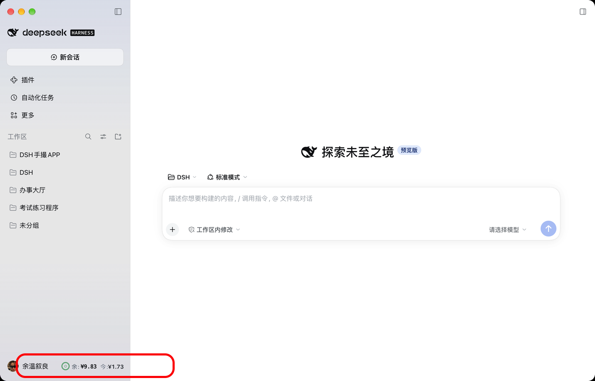
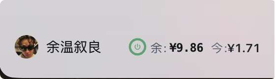
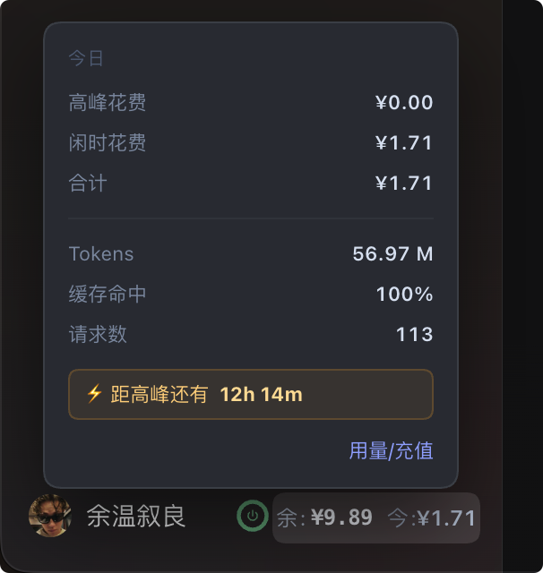

# dsh-quota-ring · DSH 余额环

**一款极简的 DeepSeek 余额查询插件。** 它藏在整个界面最不起眼的角落 —— 不新增面板、不新增按钮、不占用任何其他功能的位置 —— 却让你随时扫一眼就知道：还剩多少钱、今天花了多少、此刻用贵不贵。

> ⚠️ **仅支持 macOS** —— 重启功能依赖 `launchctl` 与 `/Applications` 路径。
>
> ✅ **无需安装 Node，无需 `npm install`** —— 插件跑在 DSH 内部，而 DSH 是 Electron 应用，自带 Node 运行时。整个插件零第三方依赖。



<sub>**它在这里** —— 左下角、账户名「余温叙良」的右边，和账户名**同一行**：`余:¥9.65` `今:¥1.92`。不额外占用高度，也不挤占任何功能区。</sub>

---

## 为什么说它"极简"

| 它不做什么 | 它做了什么 |
|---|---|
| 不弹窗打扰你 | 静静待在角落 |
| 不新增一行 | 和账户名挤在同一行 |
| 不要求你先点开某个页面 | **零点击**就能看到两个关键数字 |

实用和极简，是这个小插件唯一的追求。

---

## 功能一：零点击，余额和今日花费直接可见


<sub>**深色模式**：圆环 → 「余:¥9.89」→ 「今:¥1.71」，一眼读完。</sub>



<sub>**浅色模式**：布局完全一样，颜色自动跟随 DSH 主题。</sub>

| 显示 | 含义 |
|---|---|
| `余:¥9.89` | 账户**当前余额**（平台接口真实值） |
| `今:¥1.71` | **今天已经花了多少**（本地会话日志 + 内置价目表估算） |

---

## 功能二：圆环颜色，一眼判断此刻贵不贵

| 圆环 | 含义 |
|---|---|
| 🟡 **黄色** | **峰时** —— 单价贵（工作日 09:00–12:00、14:00–18:00） |
| 🟢 **绿色** | **闲时** —— 单价便宜 |
| 🔴 **红色** | **余额低于阈值**（默认 ¥3，可自定义）—— 环心变红 + 外围红色呼吸光晕 |

**如果今天峰时和闲时都用过怎么办？**

圆环会按**使用比例**切成两段：

- **黄色那段** = 今天在峰时花的钱占比
- **绿色那段** = 今天在闲时花的钱占比

所以整环几乎全绿，说明今天的钱基本都花在便宜时段；黄色段越长，说明越多的钱烧在了峰时。

> 💡 环**心图标**的颜色，才代表「**此刻**」是峰时还是闲时。

---

## 功能三：点击圆环，一键重启

开发插件需要**反复重启**，手动退出再打开太麻烦 —— 所以圆环直接做成了重启键。


<sub>鼠标停上去，圆环背后出现**圆形**高亮，提示"这里可以点"；**不会**弹明细面板，避免你想看数据却误触重启。</sub>


<sub>为了防止误操作，中间加了一步**确认弹窗** —— 点「是」才会重启。</sub>

几个保护措施：

| 场景 | 行为 |
|---|---|
| 请求发出中 | 关闭按钮隐藏，不能关 |
| 任务已提交 | 锁定显示「重启进行中，请稍候……」 |
| 60 秒内重复点 | 拒绝，提示「上一次重启还在进行中」 |
| 60 秒没重启成功 | 解除锁定、显示原因、允许重试 |

---

## 功能四：数字翻转 + 变色，一眼看出钱在动

数值变化时，数字会**翻动一下并变色**，停留 **1.7 秒**后恢复：


<sub>今日花费从 ¥1.71 涨到 **¥1.73** —— 整串变**黄色**。</sub>


<sub>余额从 ¥9.86 降到 **¥9.83** —— 整串变**红色**。</sub>

| 数值变化 | 颜色 |
|---|---|
| 余额**增加** | 🟢 绿色 |
| 余额**减少** | 🔴 红色 |
| 今日花费**增加** | 🟡 黄色 |
| 今日花费**减少** | 🔴 红色 |

**翻转的动效细节**：每个字符（含 `¥` 和小数点）从下方 7px 浮上来，半透明→实心，持续 0.45 秒；每个字符依次延迟 18 毫秒 —— 从左到右**一波推过去**，像老式翻牌器。

> 💡 **为什么"今日花费增加"用黄色而不是绿色？**
> 因为它是**支出**。花钱闪绿色会让人下意识觉得"情况变好了"，其实钱在流出去。
> **绿 = 好事，红 = 钱少了，黄 = 在花钱。**

---

## 功能五：悬停数值，查看今日明细

鼠标移到数字上，弹出面板：



<sub>**深色模式**：灰底面板，水平居中于侧边栏。</sub>


<sub>**浅色模式**：白底深字。</sub>

| 行 | 含义 |
|---|---|
| **今日** | 以下三行都只统计今天（本地 0 点起） |
| **高峰花费** | 今天在峰时花的钱 |
| **闲时花费** | 今天在闲时花的钱 |
| **合计** | 今天总花费 |
| **Tokens** | 今天消耗的 token 总量 |
| **缓存命中** | 缓存命中率 |
| **请求数** | 今天发了多少次请求 |
| **⚡ 距高峰还有 12h 14m** | **距离下一个峰时/闲时还有多久** |
| **用量/充值** | **一键跳转官方用量查询 / 充值页面** |

> 💡 这些是**本地估算**：读本机日志 × 内置价目表。而「余额」是接口真实值 —— 两者来源不同，不会严格同步，这是设计如此。

---

## 功能六：点击数值，立即刷新

点一下数字区域，立刻重新读取余额和今日花费。

**刷新时，圆环上会有一段缺口绕圈转动** —— 这就是刷新动画，转完就更新。

此外每 **60 秒**还会自动刷新一次。

---

## 安装

> ⚠️ **不要**把插件加进 `package.json` 的 `dsh.profile.bundles` —— 应用启动时会清空该项。请用下面的**补丁层**方式。

### 1. 克隆到插件目录

```bash
git clone https://github.com/Aya-zhang/dsh-quota-ring.git ~/.dsh/plugins/dsh-quota-ring
```

### 2. 在 profile 的 node_modules 里建立软链

```bash
ln -s ~/.dsh/plugins/dsh-quota-ring \
      ~/.dsh/profiles/desktop/node_modules/dsh-quota-ring
```

### 3. 在 profile 的补丁层注册

编辑 `~/.dsh/profiles/desktop/cordis.patch.yml`，在末尾追加：

```yaml
- insert:
    - id: quota-ring
      name: dsh-quota-ring
```

### 4. 重启 DSH

---

## 配置（可选）

### 自定义"低余额报警"的金额

默认余额低于 **¥3** 时圆环变红。想改成别的金额，在补丁层的 `insert` 里加 `config`：

```yaml
- insert:
    - id: quota-ring
      name: dsh-quota-ring
      config:
        lowBalance: 5        # ← 改成 5 元
```

改完**重启 DSH** 生效。

| 填什么 | 效果 |
|---|---|
| `5` / `10` / 任意正数 | 余额低于该金额时变红 |
| `0` | 余额为 0 才变红（相当于一直不报警） |
| 负数 / 非数字 / 留空 | 自动回到默认值 `3` |

---

## 自定义外观

配色和位置都在 `lib/client.js`，**搜索颜色值**即可：

| 想改什么 | 搜这个 | 当前值 |
|---|---|---|
| 圆环「闲时」绿 | `#6FAE86` | 灰绿 |
| 圆环「峰时」黄 | `#ffb020` | 琥珀 |
| 低余额红 | `#ff5c7a` | 红 |
| 数字上涨色 | `#96C6A9` | 灰绿 |
| 数字下跌色 | `#ff8fa3` | 红（粉调） |
| 今日花费上涨色 | `#ffb020` | 黄 |
| 悬停底色 | `rgba(255,255,255,0.17)` | 白 17% |
| 弹层 / 弹窗背景 | `#34383F` | 灰 |
| 弹层宽度 | `232` | `POP_W` 与 `.qr-pop` 的 `width` 两处必须一致 |
| 徽章上下位置 | `bottom:4px` | 调大＝上移 |
| 颜色停留时长 | `AMOUNT_TTL = 1700` | 1.7 秒 |

改完点一下圆环重启即可生效。

---

## 数据来源与隐私

- **余额**：调用 DeepSeek 官方余额接口
- **今日花费**：读取本机 DSH 会话日志（`~/.dsh/`），按内置价目表计算
- **网络**：只访问 `api.deepseek.com` 与 `platform.deepseek.com`
- **凭据**：读取本机已保存的 API Key / User Token，**不发送给任何第三方**
- 不上报、不统计、不联网存储任何数据

---

## 已知限制

1. **依赖侧边栏类名** —— 为把徽章移到账户名右侧，CSS 用了 `[class*="footArea"]` 这类选择器。DSH 更新后若改类名，徽章会退回「独占一行」（不会崩溃）。
2. **布局按 260px 侧边栏调校** —— 侧边栏宽度不同时可能需要微调。
3. **价格表固定写在代码里** —— 官方调价后估算会不准，需手动更新 `lib/index.js` 的 `PRICING`。
4. **点圆环会重启应用** —— 破坏性操作，会中断当前会话。
5. **余额与今日不会严格同步** —— 余额是接口真实值（2 位小数），今日是本地估算（4 位小数）。

---

## 测试

仓库自带纯函数自测（**30 项断言**），不启动 DSH、不联网：

```bash
ELECTRON_RUN_AS_NODE=1 "/Applications/DeepSeek Harness.app/Contents/MacOS/DeepSeek Harness" test/selftest.mjs
# 或：node test/selftest.mjs
```

| 分组 | 覆盖内容 |
|---|---|
| 请求来源校验 | 伪造 Host、恶意 Origin、cross-site、端口不一致、无 Host 均须拒绝；同源、无 Origin、`dsh-app://app` 须放行 |
| 峰谷判断 | 09:00 起始、12:00 结束、周末全天闲时 |
| 费用计算 | 闲时与高峰的单价翻倍关系 |
| 低余额阈值 | 数字、字符串、0、负数、非数字、null 的归一化 |
| 快照并发 | 4 个并发强制刷新只调用 1 次接口 |

---

## 许可

MIT
